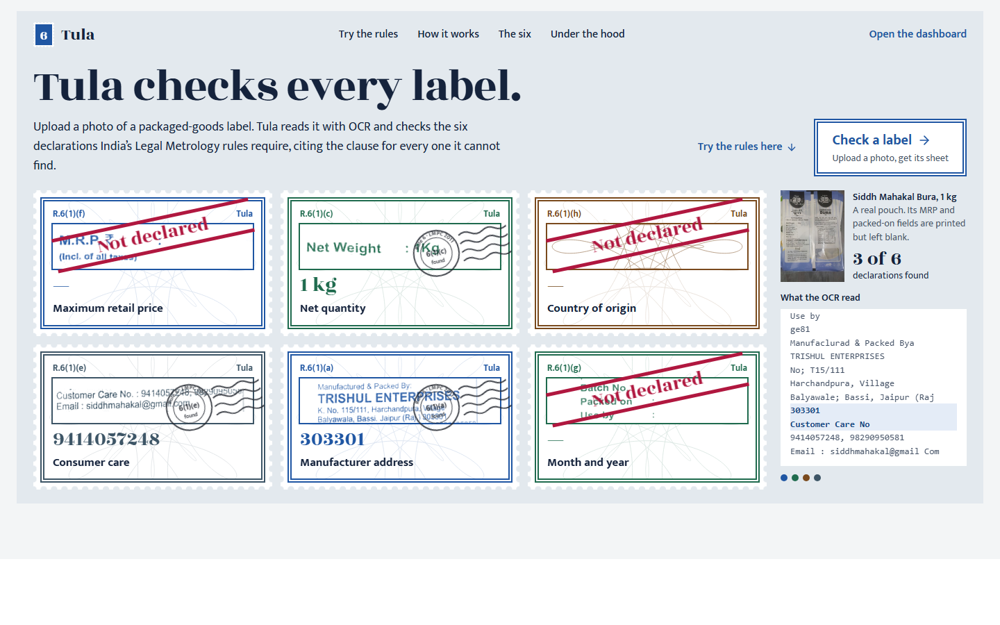
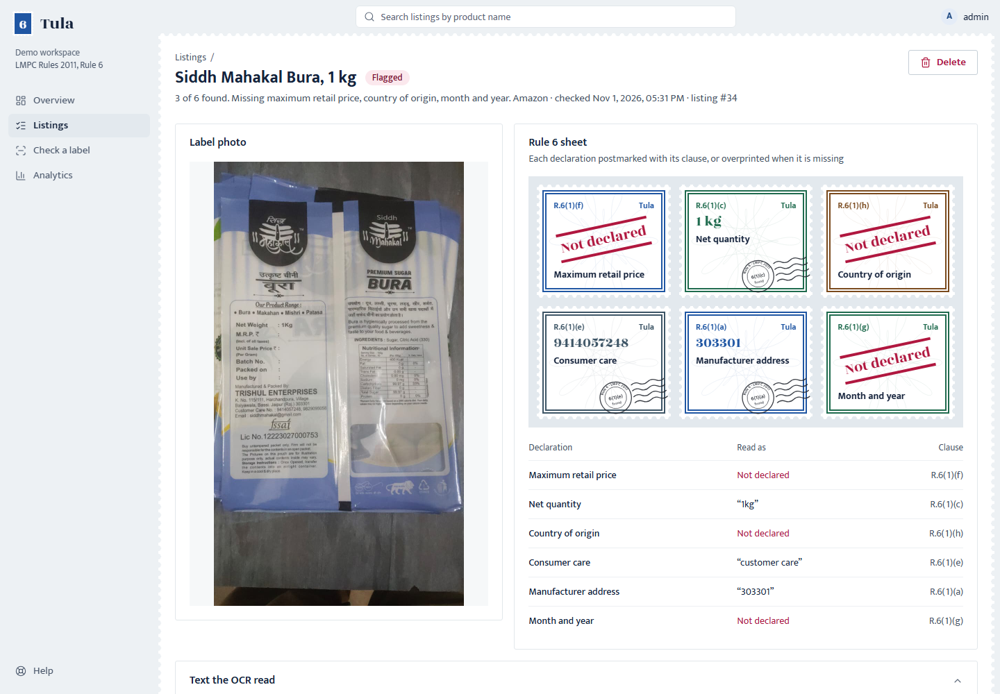
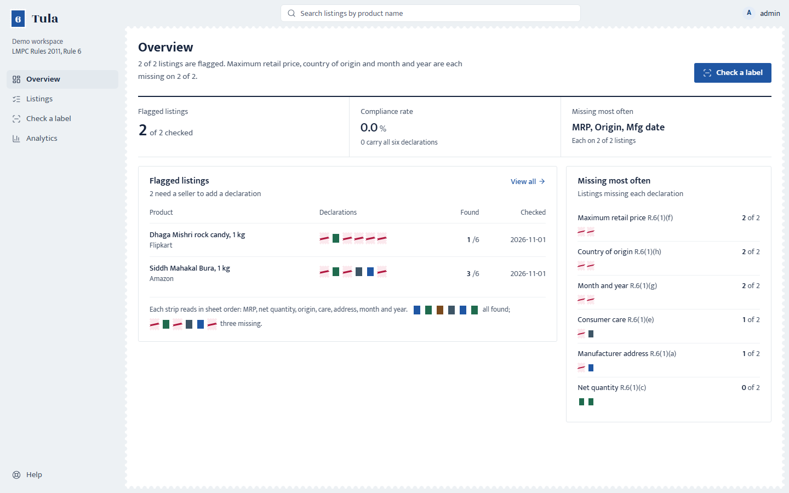

# Tula

*Tula (तुला) is the traditional Indian balance.*

**Legal Metrology label checks for Indian e-commerce listings.** Upload a photo of a
packaged-goods label; Tula reads it with OCR and checks the six declarations the
Legal Metrology (Packaged Commodities) Rules, 2011 require, citing the clause for every
one it cannot find.

[](https://github.com/OjasvaK/Automated-Legal-Metrology-Compliance-Checker-for-E-Commerce-Listings/actions/workflows/ci.yml)



Each check is issued as a sheet of six stamps, one per declaration. A declaration that
was found is postmarked with its clause; one that is missing is overprinted
*Not declared*.

| Listing detail | Overview |
|---|---|
|  |  |

## Why

India's Legal Metrology Act, 2009 and the Packaged Commodities Rules, 2011 require every
pre-packed product to declare its MRP, net quantity, country of origin, consumer-care
details, manufacturer address and month and year of manufacture. Rule 6(10), in force
since 1 January 2018, carries those declarations onto e-commerce listings. Inspectors
work listing by listing; the listings far outnumber them.

Tula is built to be **explainable by construction**: OCR only extracts the text, and
the compliance call is a plain regular expression paired with its legal citation. There
is no black-box score.

## What it checks

| Declaration | Clause | What the pattern looks for |
|---|---|---|
| Maximum retail price | Rule 6(1)(f) | "MRP" followed by ₹ or Rs and an amount |
| Net quantity | Rule 6(1)(c) | A number with g, kg, ml, l or litre |
| Country of origin | Rule 6(1)(h) | "Country of origin" or "Made in" and a word |
| Consumer care | Rule 6(1)(e) | "Consumer care", "Customer care" or "Contact us" |
| Manufacturer address | Rule 6(1)(a) | A six-digit PIN code, as evidence of a full address |
| Month and year | Rule 6(1)(g) | A month and four-digit year, such as 08/2026 |

Rule 6 lists eight declarations; the generic name and unit sale price are not checked
yet. The patterns live in [`backend/app/rules.yaml`](backend/app/rules.yaml). The
landing page's live tester uses a JavaScript copy in
[`frontend/src/lib/rules.js`](frontend/src/lib/rules.js); keep the two in step.

## Features

- **Check a label** by upload or by image URL (SSRF-guarded; no marketplace scraping).
- **Per-listing sheet** with the matched text, its clause, and the raw OCR text.
- **Listings ledger** with a six-stamp strip per row, search, platform filter, CSV export.
- **Analytics**: which declarations go missing most, by platform, per day.
- **Live rule tester** on the landing page: paste label text and watch the stamps.

## Tech stack

| Part | Built with |
|---|---|
| OCR | EasyOCR (Tesseract kept as the comparison baseline), OpenCV preprocessing |
| Rule engine | Python regex rules in YAML, each with its LMPC citation |
| API | FastAPI, SQLAlchemy, Alembic, PostgreSQL 16, JWT auth |
| Dashboard | React 19, Vite 8, Tailwind CSS 4, TanStack Query, Recharts, Framer Motion |
| Running it | Docker Compose; GitHub Actions runs the 36 backend tests against real Postgres and real OCR |

## Run it locally

You need Docker Desktop.

```bash
docker compose up -d --build
docker compose exec backend python -m app.seed_user admin dev-password-123
```

Then open <http://localhost:5173>. The dashboard signs in automatically with the demo
account above; the API docs are at <http://localhost:8000/docs>. The first check
downloads the OCR model, so it takes longer than the rest.

### Without Docker (development)

```bash
docker compose up -d db                       # just Postgres
cd backend
python -m venv ../.venv && ../.venv/Scripts/pip install -r requirements.txt
../.venv/Scripts/python -m alembic upgrade head
../.venv/Scripts/python -m app.seed_user admin dev-password-123
../.venv/Scripts/python -m uvicorn app.main:app --port 8000

cd ../frontend
npm ci
npm run dev                                    # http://localhost:5173
```

On Windows, set `PYTHONUTF8=1` before starting the API: EasyOCR's download progress bar
crashes the default console code page otherwise.

### Tests

```bash
cd backend && ../.venv/Scripts/python -m pytest tests/ -v
```

## Configuration

See [`.env.example`](.env.example).

| Variable | Where | Purpose |
|---|---|---|
| `DATABASE_URL` | API | PostgreSQL connection (`postgresql+psycopg2://…`) |
| `SECRET_KEY` | API | Signs JWTs. **Set a long random value in any real deployment.** |
| `ALLOWED_ORIGINS` | API | Comma-separated frontend origins for CORS. `*` is for local use only. |
| `VITE_API_URL` | Dashboard build | Public URL of the API |
| `VITE_DEMO_USERNAME`, `VITE_DEMO_PASSWORD` | Dashboard build | The account the dashboard signs in as |

### Before deploying publicly

- The dashboard has no sign-in screen; it signs in as the demo account, whose password
  is compiled into the JavaScript bundle. Create a dedicated demo user for it, never an
  admin or real regulator account.
- Set `SECRET_KEY`, set `ALLOWED_ORIGINS` to the dashboard's exact URL, and build the
  dashboard with `VITE_API_URL` pointing at the public API.
- Anyone with the link can upload images and delete listings in the demo.

## Project layout

```
backend/    FastAPI app, rule engine, OCR, Alembic migrations, tests
frontend/   React dashboard and landing page
  src/components/stamp/   the stamp, postmark, strip and wordmark
  public/specimen/        crops of the project's own sample label
  public/assets/          credited open-licence photographs
PRODUCT.md  product record (users, purpose, constraints)
DESIGN.md   the design system
```

## Credits

Sample label photos are the project's own. Photographs on the landing page:
"Scales and weights" (The Metropolitan Museum of Art, CC0);
"Travancore Revenue Stamp" by കാക്കര (CC BY-SA 4.0);
"Grocery Shop in a small Town in South India (1)" by Ask27 (CC BY-SA 3.0);
"A man weighing tomatoes using his Tharasu in Madurai" by எஸ்ஸார் (CC BY-SA 3.0).
Links are in the site footer and in `frontend/public/assets/credits.json`.

This is an independent portfolio project, based on the Smart India Hackathon 2025
problem statement SIH25057. It is not affiliated with the Department of Consumer Affairs.
